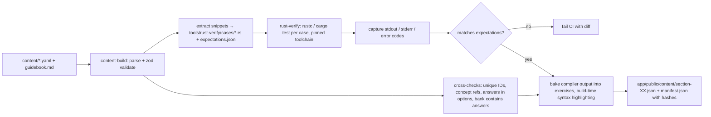

# Content format, exercise types and authoring pipeline

This covers how lessons are represented, the catalogue of exercise types (UI + grading), and how content is authored and **machine-verified against real `rustc`**.

---

## 1. Exercise type catalogue

All types work offline and are graded on the client. Every type has a tap-only interaction path; free typing is never required except in "Type it" and optional challenges.

| # | Type ID | Name | Interaction | Grading | Phase |
|---|---|---|---|---|---|
| 1 | `concept` | Concept card | Read a short explanation + code card (+ optional diagram), tap GOT IT | None (counts toward progress, not accuracy) | MVP |
| 2 | `mcq` | Multiple choice | Pick 1 of 2–4 options (text or code) | Exact option ID | MVP |
| 3 | `predict-output` | What does this print? | Code card, then choose an option, **or** assemble the output from tiles | Option ID / normalised string | MVP |
| 4 | `fill-tokens` | Fill the blanks | Code with 1–4 blanks; tap tiles from a token bank into the blanks (Duolingo word bank) | Per-blank match; each blank allows alternatives | MVP |
| 5 | `parsons` | Arrange the code | Drag (or tap in order) shuffled lines into the correct order; optional indentation step; optional distractor lines | Ordered line IDs; supports multiple valid orders | MVP |
| 6 | `compiles` | Does it compile? | Code card → YES / NO; if NO, a follow-up "Which error?" (error code options) | Boolean (+ error code) | MVP |
| 7 | `spot-bug` | Tap the bug | Tap the line (or token) that causes the error/bug | Line/token ID | MVP |
| 8 | `match-pairs` | Match pairs | Two columns of 4–5 tiles; tap left then right (Duolingo match) | All pairs matched; mismatch = mistake (heart) | MVP |
| 9 | `decode-error` | Decode the error | A real compiler error shown in terminal style + code → choose what it means **or** pick the fix (diff options) | Option ID | MVP |
| 10 | `true-false` | True or false | Statement (+ code) → TRUE / FALSE | Boolean | MVP |
| 11 | `type-it` | Type the code | Short free typing (≤ 1 line) with the Rust symbol key row; "Can't type now" skips without penalty | Token-normalised comparison against accepted answers (§3) | v1 |
| 12 | `reorder-tokens` | Build the line | Tap tokens into one line (for example build `let mut v: Vec<i32> = Vec::new();`) | Token sequence; accepted alternatives | v1 |
| 13 | `trace` | Step-through trace | Step through a program line by line; at marked steps answer "what is `x` now?" or "who owns `s`?" with a stack/heap diagram | Per-step options | v1 |
| 14 | `code-read` | Code Read (story) | Longer program revealed chunk by chunk with interleaved MCQs (Duolingo Stories) | Per-question | v1 |
| 15 | `build-step` | Build step | Multi-screen project step that combines 4/5/12 against an evolving file | Per-sub-exercise | v1 |
| 16 | `challenge` | Coding challenge | CodeMirror editor; write or complete a function; RUN (online) → tests; offline → "Compare with solution" self-check | Remote test pass (Tier 1); self-assessed offline (no XP penalty) | v1.x |

Design rules:
- **Every graded exercise has an `explanation`**, shown in the feedback sheet on both correct and wrong answers (collapsed on correct).
- Distractors must be **plausible misconceptions**, ideally tied to a concept ID (for example a distractor that reflects "thinks `let` is mutable"). Option-level `why` text explains each wrong answer.
- Code shown is ≤ 15 lines on mobile (≤ 25 in Code Reads). Prefer ≤ 40 columns; longer lines scroll horizontally.
- Hints: an optional `hint` revealed by a 💡 button (v1). Using a hint makes the answer non-perfect but doesn't cost a heart.

### 1.1 Lesson composition

A lesson is 8–15 exercises:
- First lesson of a level: 1–3 `concept` cards interleaved with easy exercises on the new idea
- Later lessons in a level: fewer concept cards, more varied and harder exercises, plus 20–30% review items pulled from earlier concepts (selected at runtime by the SRS from the level's `reviewConcepts`)
- Final lesson in a level: hardest items, including at least one "produce" exercise (fill-tokens / parsons / type-it)
- Exercises within a lesson can be authored as a **pool** larger than the lesson length. The player samples to vary replays (and Legendary uses the harder subset).

---

## 2. File layout and schema

```
content/
├── course.yaml                         # course metadata, section order, mascot id
├── LICENSE                             # CC BY-SA 4.0 (prose) + MIT OR Apache-2.0 (code snippets)
├── concepts.yaml                       # concept ID registry (id, title, section, prerequisites)
└── sections/
    └── 03-ownership/
        ├── section.yaml                # title, colour, description, unit order
        └── unit-03-borrowing/
            ├── unit.yaml               # title, level order, node types (practice/chest/code-read/checkpoint)
            ├── guidebook.md            # unit notes (Markdown + ```rust blocks)
            ├── level-01-shared-refs.yaml
            ├── level-02-mut-refs.yaml
            ├── code-read-swap-and-sum.yaml
            └── checkpoint.yaml
```

### 2.1 Unit file

```yaml
# unit.yaml
id: ownership.borrowing
title: References & Borrowing
description: Use data without taking ownership.
colour: blue
guidebook: guidebook.md
bookRef: https://doc.rust-lang.org/book/ch04-02-references-and-borrowing.html
sources:                      # validated against the licence allow-list; feeds ATTRIBUTIONS.md
  - name: The Rust Programming Language, ch. 4.2
    url: https://doc.rust-lang.org/book/ch04-02-references-and-borrowing.html
    licence: MIT OR Apache-2.0
    adapted: true
    changes: Examples rewritten as exercises; explanations paraphrased
path:
  - level: level-01-shared-refs
  - level: level-02-mut-refs
  - chest
  - level: level-03-exclusive-rule
  - code-read: code-read-swap-and-sum
  - level: level-04-nll
  - practice
  - level: level-05-dangling
  - checkpoint: checkpoint
```

### 2.2 Level file (example)

```yaml
# level-03-exclusive-rule.yaml
id: ownership.borrowing.exclusive-rule
title: One writer or many readers
icon: lock
concepts: [borrow.exclusive, err.E0499, err.E0502]
reviewConcepts: [borrow.shared, borrow.mut, own.move]
lessons:
  - id: l1
    exercises:
      - type: concept
        id: ex-concept-rule
        markdown: |
          At any moment you can have **either**:
          - any number of shared references `&T`, **or**
          - exactly one mutable reference `&mut T`.
        code:
          rust: |
            let mut s = String::from("hi");
            let a = &s;
            let b = &s;      // ✅ many readers
            println!("{a} {b}");
          verify: run
          expectStdout: "hi hi\n"

      - type: compiles
        id: ex-two-mut
        prompt: Does this compile?
        code:
          rust: |
            fn main() {
                let mut s = String::from("hi");
                let r1 = &mut s;
                let r2 = &mut s;
                println!("{r1} {r2}");
            }
          verify: compile-fail
          expectErrors: [E0499]
        answer: false
        followUp:
          prompt: Which error?
          options:
            - { id: a, text: "E0499: cannot borrow `s` as mutable more than once" }
            - { id: b, text: "E0382: borrow of moved value" }
            - { id: c, text: "E0384: cannot assign twice to immutable variable" }
          answer: a
        explanation: Two `&mut` borrows of `s` are alive at the same time (both are used in `println!`).
        concepts: [borrow.exclusive, err.E0499]

      - type: fill-tokens
        id: ex-fix-nll
        prompt: Fill the blanks so the program compiles and prints `hi!`
        code:
          rust: |
            fn main() {
                let mut s = String::from("hi");
                let r = &s;
                println!("{r}");
                let w = ___1___ s;
                w.___2___('!');
                println!("{s}");
            }
          verify: run
          expectStdout: "hi\nhi!\n"
        blanks:
          "1": { answer: ["&mut"] }
          "2": { answer: ["push"] }
        bank: ["&mut", "&", "mut", "push", "push_str", "append"]
        explanation: >
          `r`'s borrow ends after its last use (non-lexical lifetimes), so a
          mutable borrow afterwards is fine. `push` adds a `char`; `push_str` adds a `&str`.
        concepts: [borrow.nll, string.build]

      - type: decode-error
        id: ex-decode-e0502
        code:
          rust: |
            fn main() {
                let mut v = vec![1, 2, 3];
                let first = &v[0];
                v.push(4);
                println!("{first}");
            }
          verify: compile-fail
          expectErrors: [E0502]
        showCompilerOutput: true      # stderr captured at build time, rendered terminal-style
        prompt: What's the best fix?
        options:
          - id: a
            code: "let first = v[0];"
            why: "`i32` is `Copy`, so copying the value ends the borrow immediately."
          - id: b
            code: "let first = &mut v[0];"
            why: "Still a borrow alive across `push`, so it fails the same way."
          - id: c
            code: "v.clone().push(4);"
            why: "Compiles, but pushes onto a temporary clone; `v` is unchanged. Not what we want."
        answer: a
        explanation: "`push` may reallocate the vector, which would leave `first` dangling, so Rust forbids it."
        concepts: [borrow.exclusive, err.E0502, vec.borrow]

      - type: parsons
        id: ex-parsons-swap
        prompt: Arrange the lines to swap two numbers through mutable references
        lines:
          - { id: l1, text: "fn swap(a: &mut i32, b: &mut i32) {" }
          - { id: l2, text: "    let tmp = *a;" }
          - { id: l3, text: "    *a = *b;" }
          - { id: l4, text: "    *b = tmp;" }
          - { id: l5, text: "}" }
        distractors:
          - { id: d1, text: "    let tmp = a;" }
        answer: [l1, l2, l3, l4, l5]
        verify:
          harness: |
            {{solution}}
            fn main() { let (mut x, mut y) = (1, 2); swap(&mut x, &mut y); println!("{x} {y}"); }
          mode: run
          expectStdout: "2 1\n"
        explanation: Dereference with `*` to read and write through a `&mut`.
        concepts: [borrow.mut, borrow.deref]

      - type: match-pairs
        id: ex-pairs-refs
        pairs:
          - ["&T", "shared borrow"]
          - ["&mut T", "exclusive borrow"]
          - ["T", "owned value"]
          - ["*r", "dereference"]
        concepts: [borrow.shared, borrow.mut]
  - id: l2
    exercises: [ ... ]
```

### 2.3 Common fields

| Field | Applies to | Meaning |
|---|---|---|
| `id` | all | Stable slug, unique within the level. Global ID = `levelId/lessonId/exerciseId`. |
| `concepts` | graded | Concept IDs (must exist in `concepts.yaml`) |
| `difficulty` | graded | 1–5, used for Legendary sampling and placement |
| `code.rust` | most | The snippet shown to the learner |
| `code.verify` | most | `run` · `compile` · `compile-fail` · `test` · `none` (`none` needs `verifyReason`) |
| `code.wrap` | most | `auto` (default: wrap bare statements in `fn main() {}` for verification but show unwrapped) · `none` |
| `code.hidden` | most | Extra code prepended/appended only for verification (imports, helper structs) |
| `expectStdout` / `expectErrors` / `expectPanic` | verified code | Asserted by `rust-verify` |
| `explanation` | graded | Feedback-sheet text (Markdown) |
| `hint` | graded | Optional 💡 hint |
| `why` | options | Per-option explanation |

The zod schema in `tools/content-build/schema.ts` is the single source of truth. TypeScript types for the app are inferred from it with `z.infer`, so the app and the content tools never disagree.

---

## 3. Grading details

- **Option-based types** (mcq, compiles, decode-error, true-false, spot-bug): compare IDs.
- **fill-tokens / reorder-tokens:** compare token strings per blank against the `answer` list (alternatives allowed). Optional `anyOrder` groups for commutative cases (for example `a + b`).
- **parsons:** default is the exact `answer` order; `alternatives: [[...], [...]]` lists other valid orders. A build-time check verifies that every listed order compiles/passes via the harness.
- **type-it:** tokenise both the learner's input and each accepted answer with a small Rust-ish lexer (identifiers, literals, punctuation, lifetimes; whitespace and comments dropped), then compare token streams. "Almost correct" (single typo in an identifier, Levenshtein ≤ 1, a missing trailing `;`) is accepted with a "Watch the typo" note, like Duolingo.
- **predict-output (assembled):** normalise trailing whitespace and the final newline only. Spacing inside output matters, because formatting is often the point.
- **match-pairs:** each wrong pairing counts as one mistake.
- Mistakes feed: the hearts system (when enabled; new lessons only), `MistakeRecord`, and `ConceptStrength` (all concepts on the exercise).

---

## 4. Content build pipeline



### 4.1 `content-build` (TypeScript, Node)

- Parses YAML (`yaml` package) and Markdown (`markdown-it`); validates with zod
- Cross-checks:
  - All IDs unique and slug-formatted; no ID reuse across content versions without a migration note
  - Every `concepts` entry exists; every concept is taught (has a `concept` card or guidebook mention) before it is tested on the path order
  - Correct answers are present in options/banks; banks contain at least 2 distractors; no duplicate options
  - Lesson length within 8–15; unit has a checkpoint; levels have 3–5 lessons
  - Code width warnings (> 40 columns) and line count limits
- Highlighting: pre-renders Rust code to tokenised HTML/JSON (Shiki or Lezer) so the app ships no highlighter for read-only code
- Emits per-section JSON bundles + `manifest.json` (`contentVersion`, per-section hash) + generated TS types

### 4.2 `rust-verify` (Rust)

- A Cargo workspace with a pinned `rust-toolchain.toml` (stable, edition 2024)
- For every snippet: write it as an isolated case (`cases/<global-id>.rs`, applying `wrap` and `hidden`), then:
  - `run`: compile + execute with a timeout; compare stdout; optional `expectPanic`
  - `compile`: must compile (warnings allowed, unless `denyWarnings: true`)
  - `compile-fail`: must fail; the set of error codes (parsed from `--error-format=json`) must include `expectErrors`
  - `test`: append the harness/tests, then run with `rustc --test`
  - Crate dependencies (`rand`, `tokio`, `rayon`, `thiserror`, `anyhow`): cases declaring `deps:` are compiled inside a shared Cargo project with those crates vendored/locked, to keep CI fast and deterministic
- Captures rendered stderr (with `--color never`) to bake into `decode-error` exercises, so the learner sees the **real** compiler message for the pinned version
- Runs in CI on every content change; a weekly job runs against latest stable and reports drift (new lints, changed error codes) without failing the build
- Parallelised; caches by snippet hash, so unchanged snippets aren't recompiled

### 4.3 Guidebook verification

```` ```rust ```` blocks in `guidebook.md` are verified too, using mdBook-style annotations: ```` ```rust,compile_fail,E0382 ````, ```` ```rust,should_panic ````, ```` ```rust,ignore ```` (requires a reason comment).

---

## 5. Authoring workflow

1. **Outline**: for each unit, write the concept list, level breakdown and misconceptions to target (from `02-syllabus.md`) in `unit.yaml` + a short `notes.md` (not shipped)
2. **Draft**: author the levels in YAML. LLM-assisted drafting is fine, using a prompt template that includes the schema, the concept list, the misconception list and 2 gold-standard example levels.
3. **Verify**: `pnpm content:build` runs schema checks plus `rust-verify` locally (fast, cached)
4. **Preview**: the dev server has a `/dev/content/:levelId` route that plays any level directly, plus a "show all exercises" gallery view with answers shown
5. **Review checklist** (human):
   - [ ] Explanation is correct, kind and short (≤ 3 sentences)
   - [ ] Distractors are plausible and each has a `why`
   - [ ] No concept is tested before it's taught
   - [ ] Code is idiomatic for edition 2024 (clippy-clean unless the bug is the point)
   - [ ] Mobile-friendly widths; no wall of text in concept cards (≤ 60 words)
   - [ ] Australian/British or US spelling consistent with the style guide (pick one for content; code identifiers follow Rust conventions)
   - [ ] Difficulty ramps within the level
6. **Playtest**: complete the unit on a phone; note confusing items; adjust
7. **Merge**: CI green → content version bump → deployed via SW update

### 5.1 Content style guide (summary)

- Voice: friendly, concise, a little playful (the mascot can quip in concept cards; never in explanations of errors)
- Use "you"; avoid "simply", "just", "obviously"
- Always name the rule, then show it: "**One writer or many readers.** Here's why…"
- Prefer realistic names (`score`, `user_name`, `inventory`) over `foo`/`bar`
- Show compiler errors as a learning moment ("The compiler is helping here…")
- Every unit ends its guidebook with "Read more: Book §x.y · Rust by Example · Rustlings `NN_topic`"

### 5.2 Production estimate

Per level (≈ 4 lessons × ~12 exercises with pooling ≈ 50–60 exercises): about 2–3 hours of drafting + review with LLM assistance and automated verification. MVP (Sections 1–5, ~110 levels) ≈ 250–330 hours of content work. Start with a **vertical slice** (Section 1, Units 1–2) to tune the format before scaling.

---

## 6. Runtime content loading

- `manifest.json` is fetched at start (network-first, cache fallback); section bundles are fetched lazily and precached for the current and next section
- On content update: if the user is mid-lesson, keep the old bundle in memory until the lesson finishes
- The lesson player receives a `LessonPlan` (`{ lessonId, items: ExerciseRef[] }`) assembled by `domain/lesson-planner.ts`: authored exercises (sampled from pools) + SRS review items + re-queued mistakes
- Exercise renderers are registered by `type` in a map (`exercises/registry.ts`), so new types can be added without touching the player
